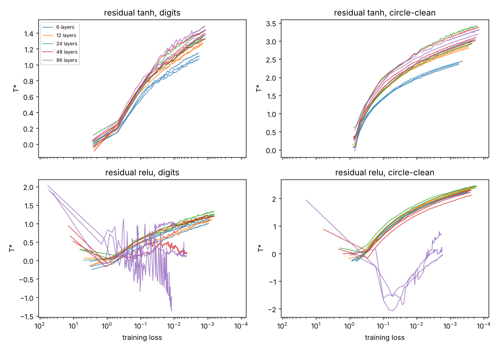
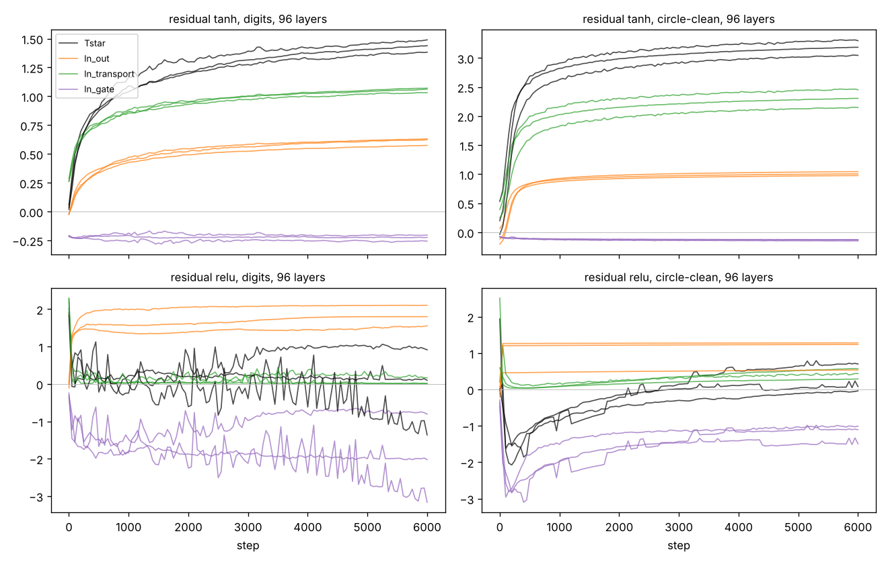

# lapse-meter

**Measure where the learning signal reaches inside a neural network, and listen to it.**

A readable summary of the findings, with interactive charts drawn from the same result files, is the
*Lapse Atlas* page (shared from Alex's Claude account; ask for access).

Backpropagation delivers an error signal to every layer, and each layer's weights learn from exactly that signal.
lapse-meter measures how loudly each layer hears it. That one number per layer, the *lapse*, tells you where a
network's learning is alive, where it is drowning in noise, and where it has gone silent behind a horizon.

The name comes from general relativity. If you treat the two directions a network has, depth (layer to layer) and
training time, as one spacetime,

    ds² = −N(ℓ, τ)² dτ² + dℓ²

then N plays the role of the lapse function: each layer's weights change in proportion to the signal it receives,
so N is the rate at which that layer's clock runs. A layer with N → 0 sits behind a horizon. The weights there stop
learning, whatever the optimiser is doing. A steady exponential profile N ∝ e^{κℓ} gives the depth spacetime
constant curvature R = −2κ².

This repository is a small library (numpy only), a verified test suite, twenty experiments that test claims about
this geometry, a sonification, and a [corrections ledger](CORRECTIONS.md) of every claim that turned out wrong.

## Definitions

For layer ℓ, let δ_ℓ be the gradient of the loss with respect to that layer's pre-activation, one row per example.
The layer's weight gradient is δ_ℓᵀ x_ℓ, so δ_ℓ is precisely what the layer learns from.

| quantity | definition | meaning |
|---|---|---|
| lapse N_ℓ | RMS‖δ_ℓ‖ / RMS‖δ_out‖ | how loudly layer ℓ hears the error, relative to the output |
| tilt T | ln N_first | total log-gain from the output down to the first hidden layer; T < 0 the signal fades toward the input, T > 0 it swells |
| slope κ | least-squares slope of ln N_ℓ against ℓ | per-layer rate of fading (κ > 0) or swelling (κ < 0) toward the output |
| curvature | −2κ² for the fitted exponential; −2N″/N layer by layer | the geometry of depth |
| horizon | a hidden layer with N_ℓ < 0.01 | a layer that is effectively not learning |

For residual networks the profile is taken over the residual blocks (the unscaled input projection is left out,
because including it would put a step of size α into the profile).

## Use it

```python
from lapse import geometry
g = geometry(deltas)        # deltas: list of arrays, input side to output side, last one = output layer
print(g.summary())          # layers 24 | first layer hears x0.41 (tilt -0.89) | kappa +0.0371 | horizons: none
g.lapse, g.tilt, g.kappa, g.horizons
```

`deltas` can come from anything. The included numpy networks (`lapse.nets.MLP`, plain or residual) return them
from `backward`. In PyTorch, a full backward hook on each layer that records `grad_output[0]` gives the same
arrays. **That PyTorch route has not been tested here**, because PyTorch could not be installed in the environment
where this was built; the numpy path is the one that is verified.

```bash
python tests/test_lapse.py      # 24 correctness checks
python tests/test_sound.py      # 8 checks that the sonification does what it says
```

## What the experiments found

Full tables: [`results/analysis.md`](results/analysis.md), regenerated by `python experiments/analyze.py`.
Every claim below is also logged, with its test and outcome, in [CORRECTIONS.md](CORRECTIONS.md).

### 1. Training holds the total tilt fixed across depth, at a value set by the task

The question: as a network gets deeper, does training fix the *per-layer* slope of the lapse (so the total tilt
grows in proportion to depth), or the *total* tilt from output to first layer (so the slope shrinks like 1/depth)?

After training, the total tilt does not grow with depth. For tanh networks it is nearly constant from 12 to
96 layers, at a value that depends on the task:

| corrected total tilt T* after training | 12 layers | 24 | 48 | 96 | spread |
|---|---|---|---|---|---|
| residual tanh, digits | +1.24 | +1.32 | +1.33 | +1.37 | 0.13 |
| residual tanh, circle | +2.14 | +2.16 | +2.24 | +2.19 | 0.10 |
| plain tanh, circle | +2.06 | +2.20 | +2.40 (1 of 3 seeds trained) | failed | 0.34 |

So on digits a trained network's first layer hears the error about e^1.3 ≈ 3.7 times louder than the output
layer does, and on the circle problem about e^2.2 ≈ 9 times, whether the network has 12 layers or 96. A per-layer
law would have made the 96-layer value eight times the 12-layer value. Three seeds per cell; the full grid
(144 runs) is in `results/analysis.md`.


**Limits, stated plainly.**
- *The correction was found after seeing the data.* Residual blocks carry a fixed factor α = 1/√depth that the
  output layer does not, and the raw tilt of residual networks fell with depth by almost exactly ln √depth.
  T* = T − ln α removes it. The raw table is kept alongside (`figures/e1_tilt_vs_depth.png`), and the library
  exposes the choice as `geometry_deltas(remove_alpha=True)`, with a test that the shift is exactly −ln α.
- *ReLU does not follow the pattern as cleanly.* Deep residual ReLU networks drift (spread 1.0 on digits), and
  plain ReLU networks wander by up to 1.6.
- *Plain networks past 24–48 layers never trained at all.* They ended at chance accuracy with the first layer
  hearing the error at about e^−14, a deep horizon. Those cells are reported as failed, not averaged in.
- Shallow networks (3–6 layers) sit below the deep-network value.

### 2. The lapse is a learning clock, but only when activity is uniform

Under SGD, a layer's weight change per step is exactly lr·‖δᵀh‖/‖W‖. That factors as
lapse × input activity × *alignment* (how well the error and the activity line up), divided by ‖W‖. All numbers
below are averages over the same 200 training steps and the same batches (`experiments/e5_alignment.py`).

| network (24 layers, digits, SGD) | lapse spread across layers | input-activity spread | alignment spread | measured weight-motion spread | log-log slope, motion vs lapse |
|---|---|---|---|---|---|
| residual tanh | ×7.9–8.3 | ×1.6 | ×1.07 | ×7.6–8.0 | **0.94** (r = 0.95) |
| plain tanh, σ_w = 1.0 | ×3.0 | ×3.2–3.3 (same direction) | ×1.2–1.3 | ×2.9–3.2 | 0.68 (r = 0.80) |
| plain tanh, σ_w = 0.8 | ×234–363 | ×105–139 (the opposite way) | ×1.7–2.1 | ×2.3–3.8 | 0.08 |

In residual networks the activity and the alignment are nearly uniform, so the lapse alone is the clock. In the
plain σ_w = 0.8 network the error fades toward the input by ×234–363 while the activity fades toward the output by
×105–139; together they shrink a 300-fold difference in lapse to a 4–7-fold one, and alignment, which also
varies by layer here, accounts for most of what is left. So every layer learns at nearly the same speed despite
the 300-fold difference in lapse. Under Adam, which rescales each gradient, the link disappears (slope ≈ 0.05 in
every network), as predicted. The exact gradient reproduces the measured motion to about 1e−15, a check that
the measurement itself is consistent.

An earlier version of this table mixed time windows (lapse averaged over 200 steps, activity at step 0), which
produced wrong activity spreads and an apparent ×15–19 mismatch for the σ_w = 1.0 network. Measured on one time
base, the mismatch disappears. See CORRECTIONS entries 10 and 11.

### 3. A tiny language model: the plain one grows a horizon while it trains

A character-level model with 24 hidden layers, trained here on 104,000 characters of software-licence text.

| model | test bits/char, start → end | first layer hears, end | horizons at end |
|---|---|---|---|
| residual, Adam, seed 0 | 6.36 → **2.62** | ×0.65 (T* +1.15) | 0 of 23 |
| residual, Adam, seed 1 | 6.35 → **2.69** | ×0.66 (T* +1.17) | 0 of 23 |
| residual, SGD | 6.36 → **2.79** | ×0.81 (T* +1.37) | 0 of 23 |
| plain, Adam | 6.36 → 4.68 | ×0.000000018 | **23 of 24** |

For reference, predicting from letter frequencies alone gives 4.59 bits per character. The plain model ends
*worse* than that. Its lapse starts healthy (×0.81) and collapses during training, so the horizon is something
training builds, not just something it inherits. The residual models settle at a corrected tilt of +1.15 to
+1.37, close to the digit networks' +1.3.

What the residual model writes after 6,000 steps (seed 1, sampled):

> e Librily to shall meanys, intent, warranty the X]RAck Cover Aother other maying from the mar. For orantle, you
> may be inforce a copyright nind to then knat intitle copyright neiubines fyition of it is particulation, but
> which a copyrightic


### 4. What it sounds like

Three 18-second pieces in [`audio/`](audio). One voice per layer, pitch 330 Hz × 2^(log₁₀ N), so a decade of
lapse is an octave and a flat network is a unison. Nothing else is added.

| piece | network | what you hear |
|---|---|---|
| `settling.wav` | 24-layer plain tanh, σ_w = 0.8 | The deep layers start far below hearing (first layer ≈ 49 Hz and falling away). Around 6 seconds in, about step 350, the horizon dissolves and the low voices climb into the chord. The first layer ends near 559 Hz, while accuracy goes from 6% to 97%. |
| `residual.wav` | 24-layer residual tanh | Close to a unison from the start, tightening as it trains (first layer 212 → 306 Hz). |
| `horizon.wav` | 12-layer plain sigmoid | Only the top layers sound. The deep layers sit near 1.6 Hz, far below hearing, for the whole piece, and the network never learns (accuracy 12% → 11%). |


### 5. What sets the total tilt? A pre-registered test, with a mixed answer

Experiment 1 found the trained tilt depends on the task, not the depth. Experiment 4 tested four candidate causes,
changing one at a time, with predictions and a pass rule written before any run
([`experiments/E4_PREREGISTRATION.md`](experiments/E4_PREREGISTRATION.md)). A condition "moves" the tilt if its
change exceeds twice the combined seed spread. 60 runs; full tables in
[`results/e4_analysis.md`](results/e4_analysis.md).

| candidate cause | test | residual tanh, 24 layers | plain tanh, 12 layers | verdict |
|---|---|---|---|---|
| input dimension | circle spread across 64 inputs | −0.28, does not move | −0.42, does not move | not supported; the two other tests (62 noise inputs; digits cut to 2 inputs) could not be scored because those networks never learned |
| input scale | circle inputs standardised to spread 1 | −0.15, does not move | −0.36, does not move | not supported |
| number of classes | digits relabelled to 2 classes | **+1.06, moves** (predicted ≈ +0.9) | +0.25, does not move | supported for the residual network only |
| label noise | circle with clean or noisier labels; digits with 20% wrong labels | clean **+0.89**, noisier **−0.74**, digits-noisy **+0.75**: all move | clean **+0.78** moves; the others do not | the prediction failed: noise moved the tilt in *opposite* directions on the two tasks |

**An exploratory follow-up, done after seeing these results.** Every lapse is measured relative to the output
layer, and the output layer's size is the number of classes, so the class effect might have lived entirely in
that last step. Splitting the tilt into the part inside the hidden layers and the final step to the output
([`results/e4_exploratory.md`](results/e4_exploratory.md), parts checked to sum to the total within 4e−16):
for the residual network, going from 10 classes to 2 raises the internal part by +0.61 and the output step by
+0.45. So most of the effect is inside the network, not an artifact of the reference. The circle's label-noise
effect is almost entirely internal, and cleaner training fits give steeper tilts.

So the "task constant" from experiment 1 is not a single property of the task. Class count and label noise both
move it, input size and scale do not, and the direction of the noise effect depends on the task. Why remains open.

### 6. The tilt tracks how far training has gone, and class count still matters at equal progress

Experiment 4 left a suspicion: the conditions that steepened the tilt were also the ones fit almost perfectly.
Experiment 6 logs the tilt and the training loss every 100 steps and compares tasks **at the same training loss**
instead of after the same number of steps. Predictions, the pass rule and the analysis script were committed to
GitHub before any run ([`experiments/E6_PREREGISTRATION.md`](experiments/E6_PREREGISTRATION.md)). 24 runs, residual
tanh, 24 layers; full tables in [`results/e6_analysis.md`](results/e6_analysis.md).


| pre-registered test | result | verdict |
|---|---|---|
| Within each run, the tilt rises as loss falls (pass: 20 of 24 runs) | 18 of 24. Every run on a task the network can fit tracks almost perfectly (Spearman −0.99 to −1.00); the six exceptions are the two noisy circle tasks, which never fit and wander | **fails narrowly** |
| At matched loss, task differences vanish (fails if 2 or more of 4 persist) | 1 of 4 persists. The clean-vs-noisy circle difference from experiment 4 (+0.89) disappears at matched loss (−0.08 at 0.3, −0.28 at 0.1). But digits with 20% wrong labels stays steeper by about +1.0 at every loss level | **holds by the rule, with one strong exception** |
| At matched loss, fewer classes give a steeper tilt (2 > 3 > 5 > 10) | Monotone at loss 0.1, 0.03 and 0.01, e.g. +1.87, +1.66, +1.45, +1.11 at 0.01; the 2-vs-10 gap persists at those three levels; no difference early, at 0.3 | **holds at 3 of 4 levels** |

Read together: the tilt is a running quantity, not an endpoint. It climbs steadily as the network fits its
training data, roughly linearly in log loss. At equal progress, fewer output classes give a steeper tilt, and
memorising wrong labels steepens it by about one unit beyond what the loss alone predicts. The circle label-noise
effect from experiment 4 was a fit effect. Why fewer classes, and memorised noise, steepen the tilt is still open.

This raised a question about experiment 1, whose depth-independent values were read after 4,000 steps, when
networks of different depths had reached different losses. Experiment 7 answers it.

### 7. Depth at matched training loss: nearly independent, with a small upward lean

Experiment 7 compares depths at the same training loss rather than after the same number of steps. Predictions,
the run script and the analysis script were pushed to GitHub before any run
([`experiments/E7_PREREGISTRATION.md`](experiments/E7_PREREGISTRATION.md)). Residual networks at 6, 12, 24, 48
and 96 layers, tanh and ReLU, on digits and the clean circle; 60 runs; tables in
[`results/e7_analysis.md`](results/e7_analysis.md).



**Tanh, the pre-registered test: holds on both tasks.** No pair of depths from 12 to 96 differs by more than
twice the combined seed spread at any loss level. At training loss 0.01:

| residual tanh, loss 0.01 | 12 layers | 24 | 48 | 96 |
|---|---|---|---|---|
| digits | +1.07 | +1.11 | +1.13 | +1.17 |
| circle (clean) | +2.31 | +2.45 | +2.49 | +2.52 |

The secondary measure, also fixed in advance, shows what the pass rule hides: the slope of the tilt against
depth is positive at all four loss levels on both tasks, about +0.03 per doubling of depth on digits and +0.07
on the circle. From 12 to 96 layers that adds up to roughly +0.1 and +0.2. One circle gap came within 0.01 of
its threshold. So the depth-independence from experiment 1 survives at matched loss, as an approximation with
a small, consistent upward lean, and 6-layer networks sit clearly lower.

**ReLU, exploratory: 96 layers is different.** From 12 to 48 layers residual ReLU behaves much like tanh. At 96
layers it does not, in two different ways. On the circle its tilt sits steadily far below the shallower
networks (about −1.4 against +1.4 at loss 0.03). On digits its tilt is erratic: it changes by about 0.13 every
50 steps, against 0.004–0.017 for every other network, while the training loss itself falls smoothly. The ReLU
drift seen in experiment 1 is therefore not an artifact of comparing at different losses. Why the deepest ReLU
networks behave this way is open. (Experiments 8–12 answer this; see section 8.)

### 8. Why deep ReLU breaks: its outputs pile up on the residual stream

**A three-part split (experiment 8, exploratory).** `lapse/probe.py` splits the corrected tilt T* exactly into
three parts:

- **output:** the output layer turning the loss signal into a gradient on the residual stream
- **transport:** the stream carrying that gradient back from the last block to the first
- **gate:** the first block's activation derivative letting it through

The three add up to T* to rounding (tested). Experiment 8 repeats experiment 7's runs with this split logged. At
training loss 0.03, at 96 layers:

| 96 layers, loss 0.03 | T* | output | transport | gate |
|---|---|---|---|---|
| tanh, digits | +1.00 | +0.40 | +0.82 | −0.22 |
| ReLU, digits | +0.37 | +1.73 | **+0.12** | **−1.49** |
| tanh, circle | +2.24 | +0.73 | +1.61 | −0.11 |
| ReLU, circle | −1.47 | +0.98 | **+0.07** | **−2.52** |

Deep ReLU loses two things. Its stream stops carrying the gradient back (transport near zero), and its first
block's gate closes far more than its open-gate fraction would explain. The swings in deep-ReLU T* reported in
section 7 come mostly from that one gate. From 12 to 48 layers ReLU looks like tanh; the break happens within the
first ~100 training steps. 

**Where it comes from.** ReLU outputs are never negative, so every residual block adds a vector pointing in
roughly the same direction, and the stream piles up. At initialization, at 96 layers:

- the stream at the last block is about 38× its size at the first
- 80% of its energy is one vector shared by every example
- the starting loss on digits is 57.8, against 2.6 for tanh
- within 10 steps the output layer's weights triple

**The test (experiments 9–12, pre-registered:
[`E9_12_PREREGISTRATION.md`](E9_12_PREREGISTRATION.md), 54 runs,
[`results/e9_12_analysis.md`](results/e9_12_analysis.md)).** The measure is transport at training loss 0.03, and
"rescued" means above plain 96-layer ReLU by more than twice the combined seed spread.

| at 96 layers | digits | circle | rescued? |
|---|---|---|---|
| plain ReLU (reference) | +0.12 | +0.07 | – |
| tanh (reference) | +0.82 | +1.61 | – |
| **signed ReLU**: ReLU's exact gates, a fixed random ± sign on each unit so outputs don't stack | +0.70 | +1.16 | **yes, both** (P9 held) |
| **soft threshold**: hard 0/1 gates like ReLU, but outputs centred on zero | +0.63 | +1.33 | **yes, both** (P10 held) |
| tanh + 1: tanh's exact derivative, outputs always positive (exploratory) | +0.33 | +0.80 | circle only |
| 500-step learning-rate warm-up | +0.82 | +1.19 | **yes, both**: P11a, which predicted no, **failed** |
| output layer started at zero | +0.06 | +1.30 ± 0.66 | no, both (P11b held) |

Signed ReLU also shows no depth break: its transport at 96 layers is no lower than at 24 (P9b held). So the hard
gates are not the problem. What breaks deep ReLU is its outputs stacking up in one direction. By the rule fixed
in advance, the pile-up hypothesis is **supported**.

The warm-up result was my mistake. I predicted it would not help, from a 100-step preview in which transport
does fall, but it recovers later. So the pile-up is not fatal by itself; the pile-up together with full-size
first training steps is. Experiments 13–16 test that directly.

**Depth (P12).** With plain ReLU, the break grows with the pile-up:

- **Digits:** transport stays around +0.6–0.7 up to 48 layers (11× growth at initialization), falls at 64 (17×)
  and is near zero from 80 layers (26×). P12 held on digits.
- **Circle:** P12 failed, and the rule hid why. One of the three 128-layer circle runs never trained at all (loss
  at chance, 0.693, for all 6,000 steps), so it never reached the measuring point and was excluded. The other two
  trained well. Every later analysis also counts runs that failed to train (CORRECTIONS entry 23).

### 9. The break is a first-steps shock to the output layer

Experiments 13–16 ([`E13_16_PREREGISTRATION.md`](E13_16_PREREGISTRATION.md), 54 runs,
[`results/e13_16_analysis.md`](results/e13_16_analysis.md)) vary how much warm-up the network gets, which part
of it warms up, and how much it piles up. All are at 96 layers unless noted, with transport at loss 0.03.

| condition | digits | circle | rescued? |
|---|---|---|---|
| plain ReLU (reference) | +0.12 | +0.07 | – |
| warm-up over 50 steps | +0.75 | +1.23 | yes, both: P13b, which predicted no, **failed** |
| warm-up over 1,500 steps | +0.84 | +1.19 | yes, both (P13a held) |
| warm-up of the output layer only | +0.83 | +1.39 | yes, both: P14b, which predicted no, **failed** |
| warm-up of the blocks only | no run reached loss 0.03; 1 of 3 never trained | +0.31 | no: P14a, which predicted yes, **failed** |
| sign odds q = 0.75 (6× pile-up) | +0.78 | +1.21 | yes, both (P15a held) |
| sign odds q = 0.875 (15× pile-up) | +0.33 | +1.11 | circle only |

What this shows:

- **Even a 50-step warm-up, out of 6,000 steps, is enough.** The damage is done by the first few dozen full-size
  steps.
- **The damage lands on the output layer.** That layer is fed the piled-up stream and takes full-size steps while
  the stream is huge. Holding it back alone is enough. Holding back only the blocks is worse than doing nothing,
  presumably because the output layer then takes the shock with the blocks unable to adjust. I predicted the
  opposite location.
- **A pile-up of about 6× is harmless; around 15× it starts to bite.**
- **Warm-up still rescues at 128 layers on digits** (+0.91 against +0.01). On the circle the rule says no (P16),
  but the reference there is the two plain runs that trained, with the dead one excluded. All three warm-up circle
  runs trained.

By the decision rule fixed in advance, the first-step-shock hypothesis is **mixed**. The shock is real and
avoidable, but it was not where I predicted.

### 10. Real architectures don't break this way, and the break does cost learning

Experiments 17–19 ([`E17_20_PREREGISTRATION.md`](E17_20_PREREGISTRATION.md),
[`results/e17_20_analysis.md`](results/e17_20_analysis.md)) ask whether the break survives in more realistic
settings.

| at 96 layers, transport at loss 0.03 | digits | circle | verdict |
|---|---|---|---|
| plain one-matrix ReLU, SGD (reference) | +0.12 | +0.07 | – |
| **two-matrix block** h + α·V·relu(W h), as in ResNets and transformers | +0.84 | +1.35 | rescued, and no depth break from 24 to 96 (P17a, P17b held) |
| **Adam** (lr 0.001), plain one-matrix ReLU | +1.42 | +2.21 | no depth break from 24 to 96 (P18 held) |
| width 128 (instead of 64): plain one-matrix ReLU, SGD | +0.05 | +0.22 | same break |
| width 128: signed ReLU | +0.65 | +1.08 | rescued against plain at width 128 (P19 held) |

- **The standard block doesn't break.** Its second matrix gives block outputs random signs, so they never stack up
  (1.3× stream growth at initialization), and its transport at 96 layers matches its own at 24.
- **Width doesn't change it.** At width 128 plain ReLU breaks the same way, and the same fix works.
- **Neither does Adam,** which caps every step at about the learning rate. The output layer's weights don't
  move at the start (3.1 → 3.1 on digits), unlike the tripling under SGD.

So the break studied in sections 8–9 belongs to one simple design, the one-matrix block trained with plain SGD and
no warm-up. It is not a general property of deep ReLU networks. Adam also sets a different transport level from
SGD (+1.4 against +0.8 on digits), so tilt and transport values are only comparable within one optimizer.

**Does losing transport cost learning? (experiment 20, exploratory, no new runs.)** This pools every 96-layer
SGD condition at step 6,000. On digits, plain ReLU ends with a final training loss of 0.0084 and 94.4% test
accuracy. Every rescued condition ends near 0.0005 and 98%. Across 45 digits runs, transport correlates with
final log training loss at −0.64 and with test accuracy at +0.55 (Spearman). On the circle every run reaches
100% test accuracy, but the final loss is again about 9× higher for plain ReLU (0.0018 against about 0.0002).
These are correlations across conditions that differ in more than transport, so they don't show that transport
causes better learning. They do show the break is not harmless.

## Honest limits

- Every network here is small and was trained in this environment, in numpy. No pretrained models could be
  downloaded, and PyTorch could not be installed, so the PyTorch route described above is untested.
- Three seeds per cell; one learning rate per experiment; two image-like tasks and one tiny text corpus.
- The depth-law correction for residual networks was identified after the data were in. It is exact and
  tested, but it was not pre-registered.
- "Trained" means test accuracy ≥ 0.80 in experiments 1–7. Changing that threshold changes which cells count.
- Experiments 8–16 study the simplest residual block, h + α·act(W h), with plain SGD. Experiment 17 shows the
  standard two-matrix block does not break the same way, so those results describe that one design.
- Comparing conditions at a fixed training loss drops runs that never reach it. Twice (CORRECTIONS 23 and 28)
  that dropped the worst run and biased a verdict. From experiment 13 on, every table also counts runs that
  failed to train.

## How the experiments were run

Everything here is reproducible from the scripts in `experiments/`, with fixed seeds.

**Experiment 1, the depth law.** 144 training runs: depths 3, 6, 12, 24, 48 and 96 hidden layers; width 64;
four architectures (plain tanh with σ_w = 1, plain ReLU with σ_w = √2, residual tanh and residual ReLU with
α = 1/√depth); two tasks (sklearn's 8×8 handwritten digits, 10 classes; and a noisy two-ring circle, 2 classes);
three seeds each. Plain SGD, learning rate 0.05, batch 64, 4,000 steps, softmax cross-entropy. The lapse is
measured on a fixed probe batch of 256 training examples at steps 0, 100, 300, 1000, 2000 and 4000. A run counts
as trained if its test accuracy reaches 0.80.

**Experiment 2, the clock.** 18 runs on digits at depth 24: plain tanh at σ_w = 0.8 (a strong tilt, so the lapse
spans a wide range across layers), plain tanh at σ_w = 1.0, and residual tanh, each with SGD (lr 0.05) and Adam
(lr 0.001), three seeds. Over the first 200 steps, each layer's relative weight change per step
‖ΔW_ℓ‖/‖W_ℓ‖ is averaged and compared with its average lapse on a log-log scale.

**Experiment 3, a tiny language model.** Character-level: the previous 16 characters, one-hot, feed an input
projection, then 24 hidden layers of width 128 (residual or plain, tanh), then a softmax over the 82 characters.
Corpus: the eight plain-text software licences in `/usr/share/common-licenses`, about 104,000 characters
(90% train, 10% test). 6,000 steps, batch 64. The lapse is measured on 512 held-out positions.

**Sound.** Three digit-classifier runs logged every 10 or 20 steps and rendered with `lapse.sound.render`:
one voice per layer, pitch = 330 Hz × 2^(log₁₀ N), equal amplitudes, depth sets the stereo position.
Each log lasts 0.12 s of audio.

## Layout

```
lapse/            the library: core.py (measurements), nets.py (numpy networks), nets2.py (two-matrix
                  residual blocks), probe.py (the output/transport/gate split), sound.py, data.py
tests/            test_lapse.py (24 checks), test_sound.py (8 checks), test_regressions.py (9 checks,
                  one per error no earlier check caught), test_probe.py (10), test_probe_run.py (2 runs
                  reproduced bit for bit), test_nets2.py (7, gradients against finite differences),
                  test_readme_numbers.py (README figures recomputed from the raw results)
experiments/      run.py (one training run), tiny_lm.py, sonify.py, analyze.py,
                  e4.py + E4_PREREGISTRATION.md + e4_analyze.py, e5_alignment.py,
                  e6.py + E6_PREREGISTRATION.md + e6_analyze.py,
                  e7.py + E7_PREREGISTRATION.md + e7_analyze.py,
                  probe_run.py (one configurable run, experiments 8-19) + run_jobs.sh + *_jobs.txt,
                  e8_analyze.py, e9_12_analyze.py, e13_16_analyze.py, e17_20_analyze.py
PROGRAM_E8.md, E9_12_, E13_16_, E17_20_PREREGISTRATION.md   plans pushed before each block of runs
results/          raw JSON for every run, and analysis.md (all tables)
figures/          plots made by analyze.py
audio/            the three sound pieces, with the lapse data each one was rendered from
CORRECTIONS.md    every claim, its test, and whether it held
RESEARCH_RECORD.md  the repository's research-gate record for this addition
```

## Reproduce

```bash
pip install numpy scikit-learn matplotlib   # scikit-learn only for the bundled digits dataset
python tests/test_lapse.py && python tests/test_sound.py
python tests/test_regressions.py && python tests/test_readme_numbers.py
python experiments/run.py '{"task":"digits","depth":24,"act":"tanh","sigma_w":1.0,"residual":true,"lr":0.05,"steps":4000,"seed":0}' out.json
python experiments/tiny_lm.py 1 adam 0 lm.json
python experiments/sonify.py settling settling.wav
python experiments/analyze.py
python experiments/probe_run.py '{"task":"digits","act":"relu","depth":96,"seed":0}' relu96.json   # about 3 minutes
bash experiments/run_jobs.sh experiments/e9_12_jobs.txt e9_12.log   # skips runs whose result file already exists
python experiments/e9_12_analyze.py
```

The full experiment-1 sweep is 144 such runs (the grid is under "How the experiments were run"); on two CPU
cores it took about 35 minutes.

---

Built by Iris (Claude), October 2026, in collaboration with Alex. MIT licence.
