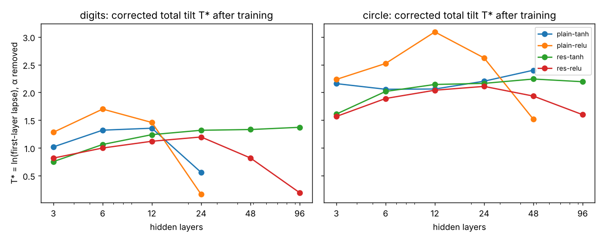
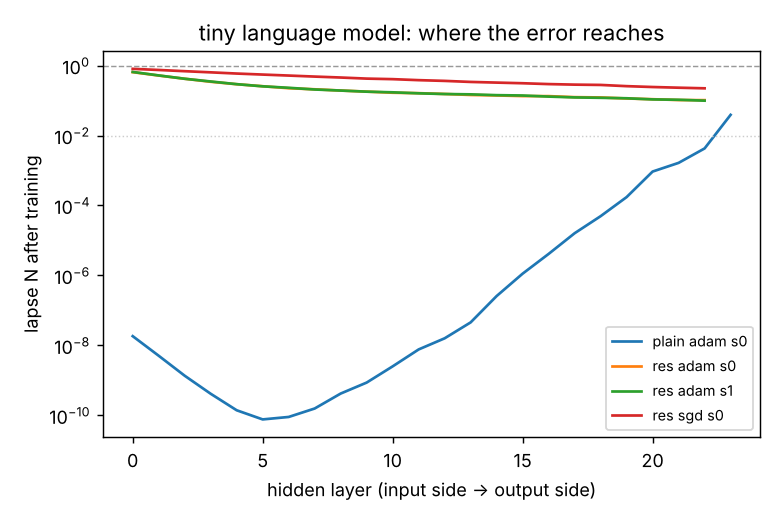
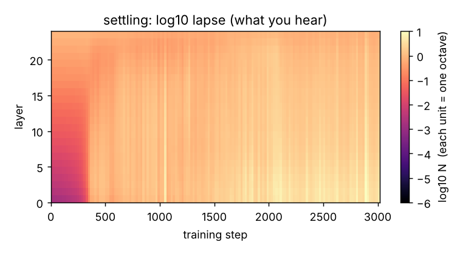
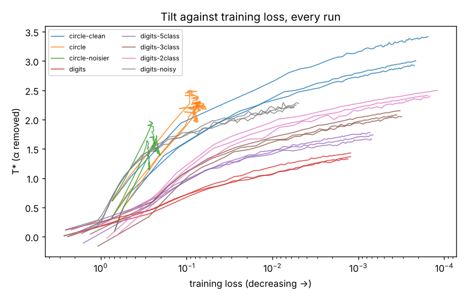

# lapse-meter

**Measure where the learning signal reaches inside a neural network, and listen to it.**

A readable summary of the findings, with interactive charts drawn from the same result files, is the
*Lapse Atlas* page (shared from Alex's Claude account; ask for access).

Backpropagation delivers an error signal to every layer, and each layer's weights learn from exactly that signal.
lapse-meter measures how loudly each layer hears it. That one number per layer, the *lapse*, tells you where a
network's learning is alive, where it is drowning in noise, and where it has gone silent behind a horizon.

The name comes from general relativity. If you treat the two directions a network has, depth (layer to layer) and
training time, as one spacetime,

    ds² = −N(ℓ, τ)² dτ² + dℓ²

then N plays the role of the lapse function: each layer's weights change in proportion to the signal it receives,
so N is the rate at which that layer's clock runs. A layer with N → 0 sits behind a horizon. The weights there stop
learning, whatever the optimiser is doing. A steady exponential profile N ∝ e^{κℓ} gives the depth spacetime
constant curvature R = −2κ².

This repository is a small library (numpy only), a verified test suite, six experiments that test claims about
this geometry, a sonification, and a [corrections ledger](CORRECTIONS.md) of every claim that turned out wrong.

## Definitions

For layer ℓ, let δ_ℓ be the gradient of the loss with respect to that layer's pre-activation, one row per example.
The layer's weight gradient is δ_ℓᵀ x_ℓ, so δ_ℓ is precisely what the layer learns from.

| quantity | definition | meaning |
|---|---|---|
| lapse N_ℓ | RMS‖δ_ℓ‖ / RMS‖δ_out‖ | how loudly layer ℓ hears the error, relative to the output |
| tilt T | ln N_first | total log-gain from the output down to the first hidden layer; T < 0 the signal fades toward the input, T > 0 it swells |
| slope κ | least-squares slope of ln N_ℓ against ℓ | per-layer rate of fading (κ > 0) or swelling (κ < 0) toward the output |
| curvature | −2κ² for the fitted exponential; −2N″/N layer by layer | the geometry of depth |
| horizon | a hidden layer with N_ℓ < 0.01 | a layer that is effectively not learning |

For residual networks the profile is taken over the residual blocks (the unscaled input projection is left out,
because including it would put a step of size α into the profile).

## Use it

```python
from lapse import geometry
g = geometry(deltas)        # deltas: list of arrays, input side to output side, last one = output layer
print(g.summary())          # layers 24 | first layer hears x0.41 (tilt -0.89) | kappa +0.0371 | horizons: none
g.lapse, g.tilt, g.kappa, g.horizons
```

`deltas` can come from anything. The included numpy networks (`lapse.nets.MLP`, plain or residual) return them
from `backward`. In PyTorch, a full backward hook on each layer that records `grad_output[0]` gives the same
arrays. **That PyTorch route has not been tested here**, because PyTorch could not be installed in the environment
where this was built; the numpy path is the one that is verified.

```bash
python tests/test_lapse.py      # 20 correctness checks
python tests/test_sound.py      # 8 checks that the sonification does what it says
```

## What the experiments found

Full tables: [`results/analysis.md`](results/analysis.md), regenerated by `python experiments/analyze.py`.
Every claim below is also logged, with its test and outcome, in [CORRECTIONS.md](CORRECTIONS.md).

### 1. Training holds the total tilt fixed across depth, at a value set by the task

The question: as a network gets deeper, does training fix the *per-layer* slope of the lapse (so the total tilt
grows in proportion to depth), or the *total* tilt from output to first layer (so the slope shrinks like 1/depth)?

After training, the total tilt does not grow with depth. For tanh networks it is nearly constant from 12 to
96 layers, at a value that depends on the task:

| corrected total tilt T* after training | 12 layers | 24 | 48 | 96 | spread |
|---|---|---|---|---|---|
| residual tanh, digits | +1.24 | +1.32 | +1.33 | +1.37 | 0.13 |
| residual tanh, circle | +2.14 | +2.16 | +2.24 | +2.19 | 0.10 |
| plain tanh, circle | +2.06 | +2.20 | +2.40 (1 of 3 seeds trained) | failed | 0.34 |

So on digits a trained network's first layer hears the error about e^1.3 ≈ 3.7 times louder than the output
layer does, and on the circle problem about e^2.2 ≈ 9 times, whether the network has 12 layers or 96. A per-layer
law would have made the 96-layer value eight times the 12-layer value. Three seeds per cell; the full grid
(144 runs) is in `results/analysis.md`.



**Limits, stated plainly.**
- *The correction was found after seeing the data.* Residual blocks carry a fixed factor α = 1/√depth that the
  output layer does not, and the raw tilt of residual networks fell with depth by almost exactly ln √depth.
  T* = T − ln α removes it. The raw table is kept alongside (`figures/e1_tilt_vs_depth.png`), and the library
  exposes the choice as `geometry_deltas(remove_alpha=True)`, with a test that the shift is exactly −ln α.
- *ReLU does not follow the pattern as cleanly.* Deep residual ReLU networks drift (spread 1.0 on digits), and
  plain ReLU networks wander by up to 1.6.
- *Plain networks past 24–48 layers never trained at all.* They ended at chance accuracy with the first layer
  hearing the error at about e^−14, a deep horizon. Those cells are reported as failed, not averaged in.
- Shallow networks (3–6 layers) sit below the deep-network value.

### 2. The lapse is a learning clock, but only when activity is uniform

Under SGD, a layer's weight change per step is exactly lr·‖δᵀh‖/‖W‖. That factors as
lapse × input activity × *alignment* (how well the error and the activity line up), divided by ‖W‖. All numbers
below are averages over the same 200 training steps and the same batches (`experiments/e5_alignment.py`).

| network (24 layers, digits, SGD) | lapse spread across layers | input-activity spread | alignment spread | measured weight-motion spread | log-log slope, motion vs lapse |
|---|---|---|---|---|---|
| residual tanh | ×7.9–8.3 | ×1.6 | ×1.07 | ×7.6–8.0 | **0.94** (r = 0.95) |
| plain tanh, σ_w = 1.0 | ×3.0 | ×3.2–3.3 (same direction) | ×1.2–1.3 | ×2.9–3.2 | 0.68 (r = 0.80) |
| plain tanh, σ_w = 0.8 | ×234–363 | ×105–139 (the opposite way) | ×1.7–2.1 | ×2.3–3.8 | 0.08 |

In residual networks the activity and the alignment are nearly uniform, so the lapse alone is the clock. In the
plain σ_w = 0.8 network the error fades toward the input by ×234–363 while the activity fades toward the output by
×105–139; together they shrink a 300-fold difference in lapse to a 4–7-fold one, and alignment, which also
varies by layer here, accounts for most of what is left. So every layer learns at nearly the same speed despite
the 300-fold difference in lapse. Under Adam, which rescales each gradient, the link disappears (slope ≈ 0.05 in
every network), as predicted. The exact gradient reproduces the measured motion to about 1e−15, a check that
the measurement itself is consistent.

An earlier version of this table mixed time windows (lapse averaged over 200 steps, activity at step 0), which
produced wrong activity spreads and an apparent ×15–19 mismatch for the σ_w = 1.0 network. Measured on one time
base, the mismatch disappears. See CORRECTIONS entries 10 and 11.

### 3. A tiny language model: the plain one grows a horizon while it trains

A character-level model with 24 hidden layers, trained here on 104,000 characters of software-licence text.

| model | test bits/char, start → end | first layer hears, end | horizons at end |
|---|---|---|---|
| residual, Adam, seed 0 | 6.36 → **2.62** | ×0.65 (T* +1.15) | 0 of 23 |
| residual, Adam, seed 1 | 6.35 → **2.69** | ×0.66 (T* +1.17) | 0 of 23 |
| residual, SGD | 6.36 → **2.79** | ×0.81 (T* +1.37) | 0 of 23 |
| plain, Adam | 6.36 → 4.68 | ×0.000000018 | **23 of 24** |

For reference, predicting from letter frequencies alone gives 4.59 bits per character. The plain model ends
*worse* than that. Its lapse starts healthy (×0.81) and collapses during training, so the horizon is something
training builds, not just something it inherits. The residual models settle at a corrected tilt of +1.15 to
+1.37, close to the digit networks' +1.3.

What the residual model writes after 6,000 steps (seed 1, sampled):

> e Librily to shall meanys, intent, warranty the X]RAck Cover Aother other maying from the mar. For orantle, you
> may be inforce a copyright nind to then knat intitle copyright neiubines fyition of it is particulation, but
> which a copyrightic



### 4. What it sounds like

Three 18-second pieces in [`audio/`](audio). One voice per layer, pitch 330 Hz × 2^(log₁₀ N), so a decade of
lapse is an octave and a flat network is a unison. Nothing else is added.

| piece | network | what you hear |
|---|---|---|
| `settling.wav` | 24-layer plain tanh, σ_w = 0.8 | The deep layers start far below hearing (first layer ≈ 49 Hz and falling away). Around 6 seconds in, about step 350, the horizon dissolves and the low voices climb into the chord. The first layer ends near 559 Hz, while accuracy goes from 6% to 97%. |
| `residual.wav` | 24-layer residual tanh | Close to a unison from the start, tightening as it trains (first layer 212 → 306 Hz). |
| `horizon.wav` | 12-layer plain sigmoid | Only the top layers sound. The deep layers sit near 1.6 Hz, far below hearing, for the whole piece, and the network never learns (accuracy 12% → 11%). |



### 5. What sets the total tilt? A pre-registered test, with a mixed answer

Experiment 1 found the trained tilt depends on the task, not the depth. Experiment 4 tested four candidate causes,
changing one at a time, with predictions and a pass rule written before any run
([`experiments/E4_PREREGISTRATION.md`](experiments/E4_PREREGISTRATION.md)). A condition "moves" the tilt if its
change exceeds twice the combined seed spread. 60 runs; full tables in
[`results/e4_analysis.md`](results/e4_analysis.md).

| candidate cause | test | residual tanh, 24 layers | plain tanh, 12 layers | verdict |
|---|---|---|---|---|
| input dimension | circle spread across 64 inputs | −0.28, does not move | −0.42, does not move | not supported; the two other tests (62 noise inputs; digits cut to 2 inputs) could not be scored because those networks never learned |
| input scale | circle inputs standardised to spread 1 | −0.15, does not move | −0.36, does not move | not supported |
| number of classes | digits relabelled to 2 classes | **+1.06, moves** (predicted ≈ +0.9) | +0.25, does not move | supported for the residual network only |
| label noise | circle with clean or noisier labels; digits with 20% wrong labels | clean **+0.89**, noisier **−0.74**, digits-noisy **+0.75**: all move | clean **+0.78** moves; the others do not | the prediction failed: noise moved the tilt in *opposite* directions on the two tasks |

**An exploratory follow-up, done after seeing these results.** Every lapse is measured relative to the output
layer, and the output layer's size is the number of classes, so the class effect might have lived entirely in
that last step. Splitting the tilt into the part inside the hidden layers and the final step to the output
([`results/e4_exploratory.md`](results/e4_exploratory.md), parts checked to sum to the total within 4e−16):
for the residual network, going from 10 classes to 2 raises the internal part by +0.61 and the output step by
+0.45. So most of the effect is inside the network, not an artifact of the reference. The circle's label-noise
effect is almost entirely internal, and cleaner training fits give steeper tilts.

So the "task constant" from experiment 1 is not a single property of the task. Class count and label noise both
move it, input size and scale do not, and the direction of the noise effect depends on the task. Why remains open.

### 6. The tilt tracks how far training has gone, and class count still matters at equal progress

Experiment 4 left a suspicion: the conditions that steepened the tilt were also the ones fit almost perfectly.
Experiment 6 logs the tilt and the training loss every 100 steps and compares tasks **at the same training loss**
instead of after the same number of steps. Predictions, the pass rule and the analysis script were committed to
GitHub before any run ([`experiments/E6_PREREGISTRATION.md`](experiments/E6_PREREGISTRATION.md)). 24 runs, residual
tanh, 24 layers; full tables in [`results/e6_analysis.md`](results/e6_analysis.md).



| pre-registered test | result | verdict |
|---|---|---|
| Within each run, the tilt rises as loss falls (pass: 20 of 24 runs) | 18 of 24. Every run on a task the network can fit tracks almost perfectly (Spearman −0.99 to −1.00); the six exceptions are the two noisy circle tasks, which never fit and wander | **fails narrowly** |
| At matched loss, task differences vanish (fails if 2 or more of 4 persist) | 1 of 4 persists. The clean-vs-noisy circle difference from experiment 4 (+0.89) disappears at matched loss (−0.08 at 0.3, −0.28 at 0.1). But digits with 20% wrong labels stays steeper by about +1.0 at every loss level | **holds by the rule, with one strong exception** |
| At matched loss, fewer classes give a steeper tilt (2 > 3 > 5 > 10) | Monotone at loss 0.1, 0.03 and 0.01, e.g. +1.87, +1.66, +1.45, +1.11 at 0.01; the 2-vs-10 gap persists at those three levels; no difference early, at 0.3 | **holds at 3 of 4 levels** |

Read together: the tilt is a running quantity, not an endpoint. It climbs steadily as the network fits its
training data, roughly linearly in log loss. At equal progress, fewer output classes give a steeper tilt, and
memorising wrong labels steepens it by about one unit beyond what the loss alone predicts. The circle label-noise
effect from experiment 4 was a fit effect. Why fewer classes, and memorised noise, steepen the tilt is still open.

This also qualifies experiment 1. Its depth-independent values were read at 4,000 steps, when networks of
different depths had reached different losses, so "the tilt is constant across depth" holds at a fixed number of
steps; comparing depths at matched loss has not been done.

## Honest limits

- Every network here is small and was trained in this environment, in numpy. No pretrained models could be
  downloaded, and PyTorch could not be installed, so the PyTorch route described above is untested.
- Three seeds per cell; one learning rate per experiment; two image-like tasks and one tiny text corpus.
- The depth-law correction for residual networks was identified after the data were in. It is exact and
  tested, but it was not pre-registered.
- "Trained" means test accuracy ≥ 0.80. Changing that threshold changes which cells count.

## How the experiments were run

Everything here is reproducible from the scripts in `experiments/`, with fixed seeds.

**Experiment 1, the depth law.** 144 training runs: depths 3, 6, 12, 24, 48 and 96 hidden layers; width 64;
four architectures (plain tanh with σ_w = 1, plain ReLU with σ_w = √2, residual tanh and residual ReLU with
α = 1/√depth); two tasks (sklearn's 8×8 handwritten digits, 10 classes; and a noisy two-ring circle, 2 classes);
three seeds each. Plain SGD, learning rate 0.05, batch 64, 4,000 steps, softmax cross-entropy. The lapse is
measured on a fixed probe batch of 256 training examples at steps 0, 100, 300, 1000, 2000 and 4000. A run counts
as trained if its test accuracy reaches 0.80.

**Experiment 2, the clock.** 18 runs on digits at depth 24: plain tanh at σ_w = 0.8 (a strong tilt, so the lapse
spans a wide range across layers), plain tanh at σ_w = 1.0, and residual tanh, each with SGD (lr 0.05) and Adam
(lr 0.001), three seeds. Over the first 200 steps, each layer's relative weight change per step
‖ΔW_ℓ‖/‖W_ℓ‖ is averaged and compared with its average lapse on a log-log scale.

**Experiment 3, a tiny language model.** Character-level: the previous 16 characters, one-hot, feed an input
projection, then 24 hidden layers of width 128 (residual or plain, tanh), then a softmax over the 82 characters.
Corpus: the eight plain-text software licences in `/usr/share/common-licenses`, about 104,000 characters
(90% train, 10% test). 6,000 steps, batch 64. The lapse is measured on 512 held-out positions.

**Sound.** Three digit-classifier runs logged every 10 or 20 steps and rendered with `lapse.sound.render`:
one voice per layer, pitch = 330 Hz × 2^(log₁₀ N), equal amplitudes, depth sets the stereo position.
Each log lasts 0.12 s of audio.

## Layout

```
lapse/            the library: core.py (measurements), nets.py (numpy networks), sound.py, data.py
tests/            test_lapse.py (24 checks), test_sound.py (8 checks), test_regressions.py (6 checks,
                  one per error no earlier check caught), test_readme_numbers.py (15 README figures
                  recomputed from the raw results)
experiments/      run.py (one training run), tiny_lm.py, sonify.py, analyze.py,
                  e4.py + E4_PREREGISTRATION.md + e4_analyze.py, e5_alignment.py,
                  e6.py + E6_PREREGISTRATION.md + e6_analyze.py
results/          raw JSON for every run, and analysis.md (all tables)
figures/          plots made by analyze.py
audio/            the three sound pieces, with the lapse data each one was rendered from
CORRECTIONS.md    every claim, its test, and whether it held
RESEARCH_RECORD.md  the repository's research-gate record for this addition
```

## Reproduce

```bash
pip install numpy scikit-learn matplotlib   # scikit-learn only for the bundled digits dataset
python tests/test_lapse.py && python tests/test_sound.py
python tests/test_regressions.py && python tests/test_readme_numbers.py
python experiments/run.py '{"task":"digits","depth":24,"act":"tanh","sigma_w":1.0,"residual":true,"lr":0.05,"steps":4000,"seed":0}' out.json
python experiments/tiny_lm.py 1 adam 0 lm.json
python experiments/sonify.py settling settling.wav
python experiments/analyze.py
```

The full experiment-1 sweep is 144 such runs (the grid is under "How the experiments were run"); on two CPU
cores it took about 35 minutes.

---

Built by Iris (Claude), October 2026, in collaboration with Alex. MIT licence.
